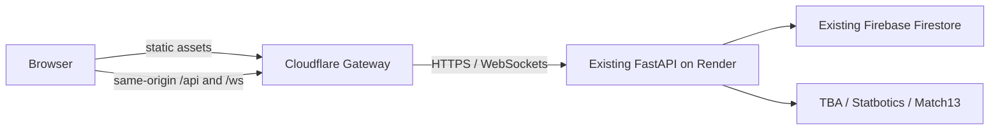

# Active deployment: Firestore through Render

The latest requirements supersede the D1 migration prototype. Only
`gateway/wrangler.jsonc` is deployed by `deploy:staging`. It has **no D1,
Queue, Durable Object, or domain Worker binding**. Existing `domain/`, D1
migrations and their tests are historical experiments, not production routes.
Do not run their migration/deployment commands against production.



Passwords, signed sessions, roles, UUID deduplication and writes remain on the
existing backend. No password reset or hash conversion is required. Keep the
existing Render signing secret. A missing/expired session correctly returns
401; connectivity errors are 503 and never converted into 401 by the gateway.
No private/authentication response is put in Cloudflare's shared cache.

The server-only `shared/firestore.ts` adapter implements RS256 service-account
OAuth, single-flight token refresh, document/batch reads, structured queries,
conditional commits and bounded transaction retries. It is NOT wired to live
writes: route parity and real Workers Free CPU testing are prerequisites. The
existing scrypt password verifier must not be weakened to fit a CPU budget.
Service-account JSON must only enter a Worker secret, never NEXT_PUBLIC vars.

Local development: `frontend` runs on localhost:3000 with API localhost:8000.
Public hosts always use relative `/api/*`; stale `.env.local` no longer overrides
this. The export script clears NEXT_PUBLIC_API_URL, sets HAZEHUB_STATIC_EXPORT=1,
and scans every compiled HTML/JS file for localhost API URLs and checks PWA meta.

From `cloudflare`:

```sh
npm ci
npm run typecheck
npm test
npm run build:frontend
npx wrangler deploy --dry-run -c gateway/wrangler.jsonc
npm run deploy:staging
```

This publishes only the staging workers.dev hostname. Do not add a production
domain route before the full staging acceptance suite. Rollback is routing the
frontend to its previous deployment; Render and all Firestore records remain
intact. Do not delete or recreate the Firebase project.

Verified references:
- [Firestore REST authentication](https://docs.cloud.google.com/firestore/native/docs/use-rest-api)
- [Service-account OAuth JWT exchange](https://developers.google.com/identity/protocols/oauth2/service-account)
- [Workers limits](https://developers.cloudflare.com/workers/platform/limits/)

Local tests verify proxy bodies, authorization, cookies, 401/304 statuses,
WebSocket echo, JWT signatures, token-refresh deduplication and transaction
preconditions/retries. These are not measurements of live Firestore or Free-plan
CPU limits.
